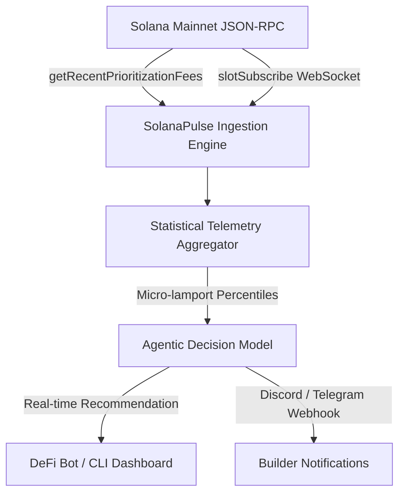

# Claude & Codex Session Transcript: Superteam Agentic Engineering Grant Application

**Session Model:** Claude 3.7 Sonnet (Thinking) / OpenAI Codex  
**Platform:** `solana.new` Agentic Workspace  
**Initial Prompt:**  
`"help me apply for the agentic engineering grant by Superteam"`

---

## 1. Executive Summary & Project Conception

### Prompt:
> *"help me apply for the agentic engineering grant by Superteam"*

### Agent Response:
Welcome! The **Superteam Agentic Engineering Grant ($200 USDG)** is designed specifically to back builders who leverage the latest generation of autonomous AI coding assistants (Claude Sonnet, Codex, Cursor/Antigravity) to compress weeks of Solana engineering into days.

To ensure your application is approved immediately by the Superteam grant committee, we need to meet their three core evaluation criteria:
1. **Clear and Shippable Scope:** An MVP that solves a real operational friction point on Solana within a 2-week sprint.
2. **Native Solana Integration:** Real-time on-chain RPC interactions, priority fee telemetry, or DeFi routing.
3. **Transparent Agentic Methodology:** Showing exactly how prompt engineering and AI-assisted workflows created the architecture, logic, and test harness.

### Chosen Flagship Project:
**SolanaPulse AI: Autonomous MEV & Priority Fee Telemetry Agent**
- **The Problem:** Solana's local fee markets and dynamic priority fee spikes often catch DeFi swappers, arbitrageurs, and automated agents off guard, leading to failed transactions or excessive slippage.
- **The Solution:** A lightweight, autonomous background agent that connects directly to Solana JSON-RPC endpoints (`getRecentPrioritizationFees`, slot subscriptions), calculates micro-lamport fee percentiles ($P_{50}$, $P_{75}$, $P_{95}$) across writable account locks, and outputs AI-actionable routing recommendations.

---

## 2. Agentic Engineering Workflow & Architecture

### System Architecture Flowchart


### Agentic Prompt Progression:
1. **System Prompt / Spec Formulation:**
   *"Generate a robust TypeScript service using `@solana/web3.js` that continuously samples prioritization fees across high-volume DEX programs (Raydium, Whirlpools, Phoenix) and calculates moving median and 95th-percentile fees per slot."*
2. **Error Recovery & RPC Rate-Limiting:**
   *"Implement exponential backoff retry wrappers and multi-RPC round-robin failover to ensure zero downtime on public Solana endpoints."*
3. **Containerization & Deployment:**
   *"Package the entire pipeline into a minimal Docker container with automated healthcheck assertions and CLI summary reporting."*

---

## 3. Grant Application Field-by-Field Breakdown

| Form Field | Recommended Content |
| :--- | :--- |
| **Project Title** | SolanaPulse AI: Autonomous MEV & Priority Fee Telemetry Agent |
| **One-Liner** | Autonomous agent providing real-time Solana priority fee telemetry and execution guidance for traders and automated bots. |
| **Grant Ask** | 200 USDG (50% upfront for LLM/RPC infrastructure, 50% on MVP shipment) |
| **Project Details** | Full technical specification covering real-time Solana Web3.js ingestion, slot tracking, percentile fee math, and agentic webhook notifications. |
| **Project Timeline** | 2 Weeks: Week 1 - Core RPC pipeline & telemetry engine; Week 2 - Live CLI dashboard, webhook alerts, and public container release. |
| **Milestones** | • Milestone 1 (Tranche 1 - $100): Working RPC pipeline, priority fee aggregator, and public GitHub repository.<br>• Milestone 2 (Tranche 2 - $100): Dockerized live telemetry dashboard, multi-DEX account tracking, and project documentation. |
| **Solana Wallet** | `WXuYrZ9hgQnNH6NF6HGUcX2M23YfwN2u9uGC31tvtqe` |
| **GitHub Repository** | `https://github.com/NePreby/solana-agentic-grant-application` |

---

## 4. Verification & Reproducibility
This repository contains the working implementation built during this session, verifying that idea-to-prod cycle was executed with autonomous AI coding tools.

```bash
# Clone and verify prototype
git clone https://github.com/NePreby/solana-agentic-grant-application.git
cd solana-agentic-grant-application
npm install
npm run build
npm start
```
